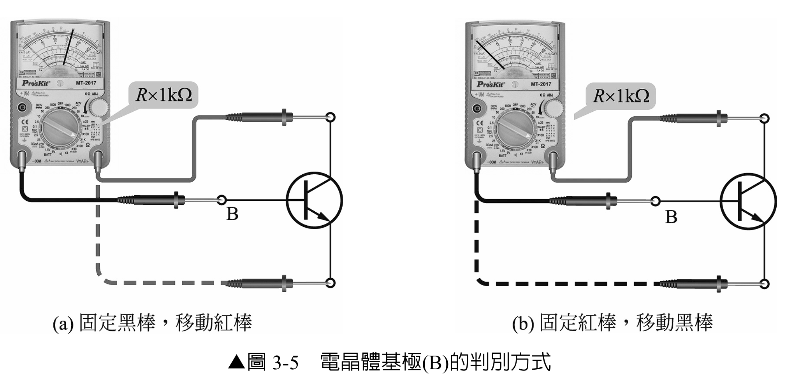
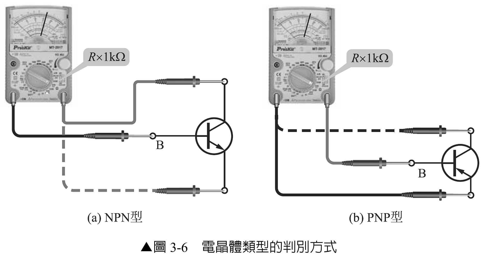
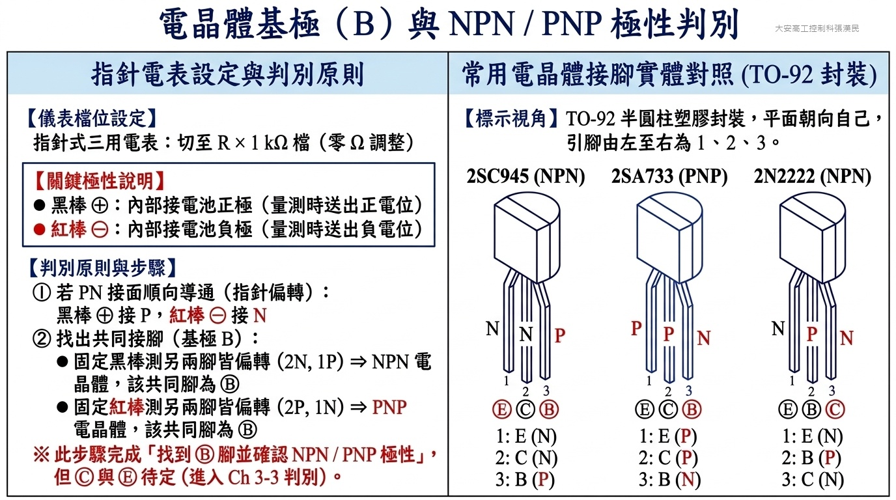
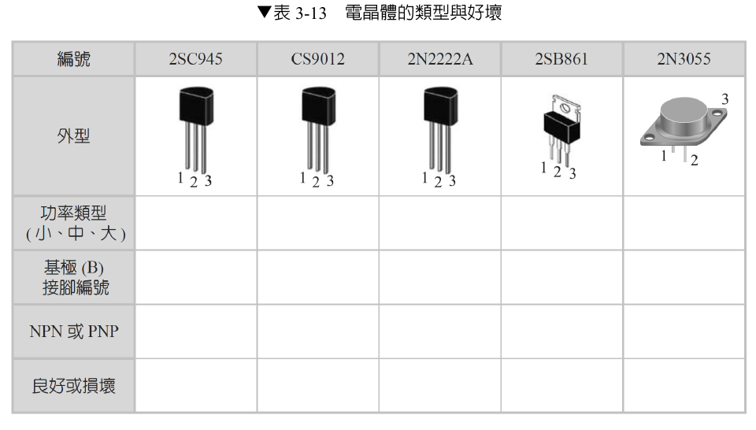

# 實習 3-2　NPN 及 PNP 之判別

> 原始教材：[實習3-2.pdf](實習3-2.pdf)　｜　建議課時：2 節

## 一、學習目標

完成本實習後，學生應能：

1. 將 BJT 視為 B-E、B-C 兩個共用基極的 PN 接面，解釋其電表讀值。
2. 使用指針三用電表找出基極，判斷 NPN 或 PNP。
3. 判斷 B-E、B-C 接面以及 C-E 間是否有短路、開路或漏電異常。
4. 分辨指針表電阻檔與數位表二極體檔的測試棒極性差異。
5. 完整記錄每一組測試方向，避免只憑單一讀值判斷元件。

## 二、器材與元件

| 類別 | 品名 | 數量 |
|---|---|---:|
| 元件 | 2SC945、CS9012、2N2222A、2SB861、2N3055 | 各 1 |
| 儀器 | 指針三用電表，具 R×1 kΩ 檔 | 1 |
| 選用儀器 | 具二極體檔的數位萬用電表 | 1 |
| 資料 | 對應製造商資料手冊 | 各 1 |
| 其他 | 元件盒、標籤紙 | 1 組 |

## 三、實習知識

> 以下為原文填空題目，請於實作前先自行完成。

1. 任選電晶體的兩個接腳，將測試棒接觸此兩個接腳，使三用電表指針大幅偏轉，此時這兩個接腳中必有一個接腳為 **\_\_\_\_\_\_\_\_\_\_**。若接觸基極(B)的指針三用電表測試棒為黑色，則此電晶體為 **\_\_\_\_\_\_\_\_\_\_** 型。反之，接觸基極(B)的測試棒為紅色，則此電晶體為 **\_\_\_\_\_\_\_\_\_\_** 型。

2. 以三用電表測量 B、E 接腳或 B、C 接腳時，均為順向 **\_\_\_\_\_\_\_\_\_\_**、逆向 **\_\_\_\_\_\_\_\_\_\_\_**（如同二極體的特性），表示此電晶體是良好的。反之，若為順向、逆向皆 **\_\_\_\_\_\_\_\_\_\_\_**，或為順向、逆向皆 **\_\_\_\_\_\_\_\_\_\_\_**，則表示此電晶體是損壞的。

## 四、工作原理

### 3-1　BJT 的接面等效觀念

BJT 具有 B、E、C 三個端子。就靜態接面測試而言，可以先把它看成兩個共用基極的二極體：

- B-E 接面是一個 PN 接面。
- B-C 接面是另一個 PN 接面。
- 良好元件的兩個接面都應呈現「順向導通、逆向截止」。
- 基極未加偏壓時，C-E 之間通常應近似不導通。

因此，只要找到某一腳在同一測試棒極性下，對其餘兩腳都呈現順向導通，該共同腳通常就是基極 B。

### 3-2　NPN 與 PNP 的接面方向

| 類型 | 基極材料 | 順向測試條件 | 數位表二極體檔 |
|---|---|---|---|
| NPN | P 型 | 基極相對 E、C 為正 | 紅棒接 B，黑棒接 E 或 C時導通 |
| PNP | N 型 | 基極相對 E、C 為負 | 黑棒接 B，紅棒接 E 或 C 時導通 |

### 3-3　指針表電阻檔的極性陷阱

原教材使用指針三用電表的 R×1 kΩ 檔。許多指針表在電阻檔時：

- 黑棒為內部電池正端。
- 紅棒為內部電池負端。

因此原教材的判讀為：

- 黑棒接基極時，對另外兩腳都大幅偏轉：通常為 NPN。
- 紅棒接基極時，對另外兩腳都大幅偏轉：通常為 PNP。

> **重要：** 不同型號儀表可能不同。實驗前必須用已知二極體確認測試棒實際極性，不可只依棒身顏色推測。數位萬用電表二極體檔通常是紅棒為正，判讀方向正好與上述常見指針表相反。

### 3-4　良好與故障元件的典型現象

| 測試結果 | 可能狀態 |
|---|---|
| B-E、B-C 各自單向導通，反向截止；C-E 雙向截止 | 通常良好 |
| 任一接面正、反向都低阻 | 接面短路或漏電嚴重 |
| 任一接面正、反向都不導通 | 接面開路、接觸不良或腳位判斷錯誤 |
| C-E 在基極懸空時雙向明顯導通 | C-E 短路、漏電或元件並非一般單顆 BJT |

指針偏轉大小只適合作相對判斷，不能當成精確 hFE 或額定電流。達靈頓電晶體、內建電阻電晶體與特殊功率元件可能呈現不同結果，應查閱資料手冊。

## 五、安全與操作規範

- 所有元件必須完全離開帶電電路後才可使用 Ω 檔或二極體檔量測。
- 切換電表檔位、歸零或更換元件前，先移開測試棒。
- 指針表使用 R×1 kΩ 檔後必須短接兩棒做歸零調整；若無法歸零，先更換電池或檢查測試線。
- 不可用 R×1 Ω 等高測試電流檔長時間量測小訊號接面。
- 測試功率電晶體時避免探棒滑動造成腳位短接；金屬外殼可能是集極。
- 元件若仍焊在電路板上，其他元件會形成並聯路徑，判讀可能失真；本實習以離板元件為準。

## 六、實習一：找出基極並判斷類型

### 5-1　準備與編號

1. 依實物正面、定位缺口或金屬外殼特徵，暫將三個端子編為 1、2、3。
2. 先不要使用資料手冊答案，以電表完成盲測；量測後再用資料手冊驗證。
3. 依外型初步記錄小功率、中功率或大功率，但不可把外型當成最終功率額定值。
4. 指針表切至 R×1 kΩ，短接測試棒並調整 0 Ω。

### 5-2　尋找共同基極

1. 黑棒固定接腳 1，紅棒依序接腳 2、3，記錄偏轉。
2. 紅、黑棒互換，重複兩次量測。
3. 再把固定端改為腳 2 與腳 3，重複上述步驟。
4. 若某一固定腳在相同棒色下，對另外兩腳都大幅偏轉，該固定腳通常是 B。
5. 若移動到第三腳後仍偏轉，未移動的腳是共同基極；若移動後不偏轉，需重新檢查哪一支棒實際固定在共同端。

### 5-3　判斷 NPN 或 PNP

在已確認本指針表 R×1 kΩ 檔「黑棒為正」的前提下：

- 黑棒固定於 B，紅棒接另外兩腳均偏轉：判為 NPN。
- 紅棒固定於 B，黑棒接另外兩腳均偏轉：判為 PNP。

若使用數位表二極體檔：

- 紅棒固定於 B，黑棒接另外兩腳均約 0.55–0.75 V：判為 NPN。
- 黑棒固定於 B，紅棒接另外兩腳均約 0.55–0.75 V：判為 PNP。

下圖整理指針三用電表歐姆檔之極性特性（黑棒為內部電池正極、紅棒為負極）、判別共同基極與極性之完整口訣，並列出常用 TO-92 電晶體（2SC945、2SA733、2N2222）實體外型與接腳對照，供盲測完成後進行交叉比對：

## 七、實習二：判斷元件好壞

### 6-1　六方向完整量測

不要只量兩次。每顆元件至少記錄 1→2、2→1、1→3、3→1、2→3、3→2 六種方向。

| 元件 | 固定棒色／極性 | 固定腳 | 移動腳 | 指針偏轉或電壓 | 導通／截止 | 接面判定 |
|---|---|---:|---:|---:|---|---|
|  |  | 1 | 2 |  |  |  |
|  |  | 2 | 1 |  |  |  |
|  |  | 1 | 3 |  |  |  |
|  |  | 3 | 1 |  |  |  |
|  |  | 2 | 3 |  |  |  |
|  |  | 3 | 2 |  |  |  |

### 6-2　判斷標準

1. 找到基極後，確認 B-E 與 B-C 均只有一個方向導通。
2. 將基極懸空，量測 C-E 正、反兩方向；通常都應近似截止。
3. 若任一接面雙向低阻，判定短路或漏電異常。
4. 若所有方向都不導通，先清潔接腳並確認接觸，再判定開路。
5. 將電表結果與資料手冊的 NPN／PNP 及接腳資料交叉確認。

| 編號 | 初判功率類型 | 基極腳號 | NPN／PNP | B-E 接面 | B-C 接面 | C-E 隔離 | 良好／損壞 | 資料手冊驗證 |
|---|---|---:|---|---|---|---|---|---|
| 2SC945 |  |  |  |  |  |  |  |  |
| CS9012 |  |  |  |  |  |  |  |  |
| 2N2222A |  |  |  |  |  |  |  |  |
| 2SB861 |  |  |  |  |  |  |  |  |
| 2N3055 |  |  |  |  |  |  |  |  |

## 八、數位表交叉驗證

若現場備有數位萬用電表，可用二極體檔重測 B-E、B-C：

| 元件 | VBE 順向 | VBE 反向 | VBC 順向 | VBC 反向 | C-E 正向 | C-E 反向 |
|---|---:|---:|---:|---:|---:|---:|
|  |  |  |  |  |  |  |

一般矽 BJT 的兩個順向接面常約 0.55–0.75 V，但實際值會受測試電流、溫度與元件結構影響。讀值不在此範圍時，應先查資料手冊，而不是立即判定損壞。

## 九、常見錯誤與排除方式

| 現象 | 常見原因 | 排除方式 |
|---|---|---|
| NPN、PNP 判斷與資料手冊相反 | 把指針表與數位表極性混用 | 用已知二極體確認電阻檔實際極性 |
| 所有方向都高阻 | 未歸零、測試棒接觸不良或接面開路 | 重新歸零、清潔接腳並重測 |
| 所有方向都低阻 | 元件仍在電路中或已短路 | 取下元件後重測 |
| C-E 有單向導通 | 基極未真正懸空、手指漏電或特殊元件 | 移開手指、清潔元件並查資料手冊 |
| 同型號結果不同 | 製造商、封裝或元件狀態不同 | 核對完整印字與對應資料手冊 |

## 十、完成檢核

- [ ] 已用已知二極體確認指針表 R×1 kΩ 檔的實際極性。
- [ ] 每顆元件均完成六方向量測，而非只記錄兩個讀值。
- [ ] 已分別判定 B-E、B-C 與 C-E 狀態。
- [ ] NPN／PNP 與基極腳號均以資料手冊交叉確認。
- [ ] 量測過程中元件完全斷電且離開並聯電路。
- [ ] 電表使用完畢後已離開 Ω 檔並完成器材歸位。
