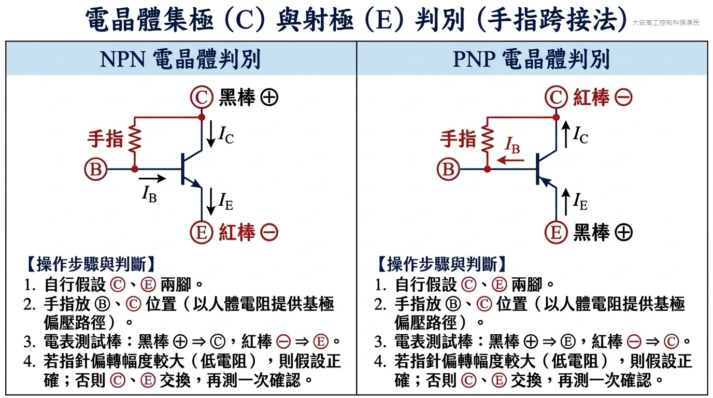
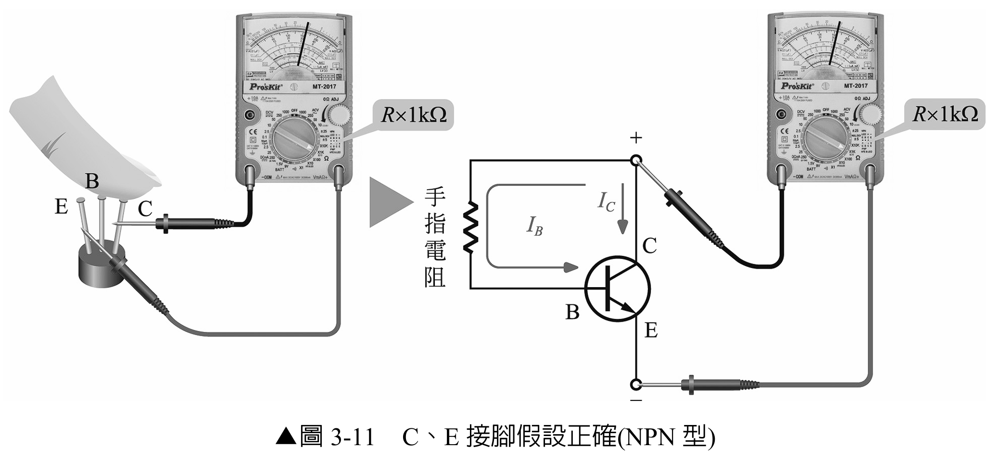
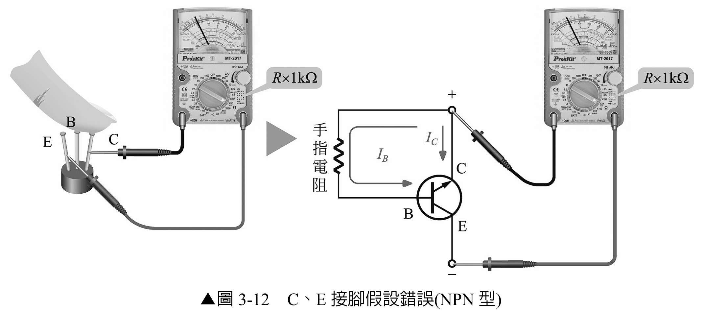
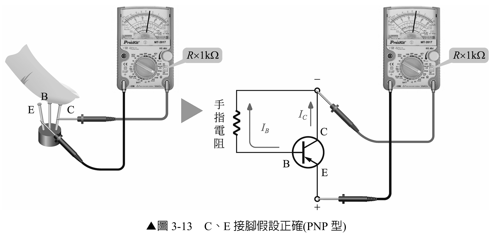
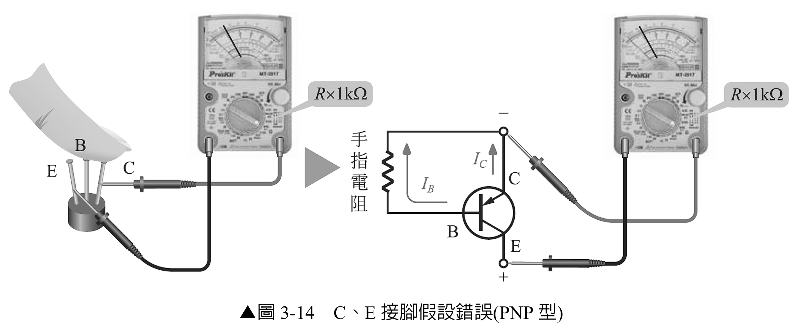
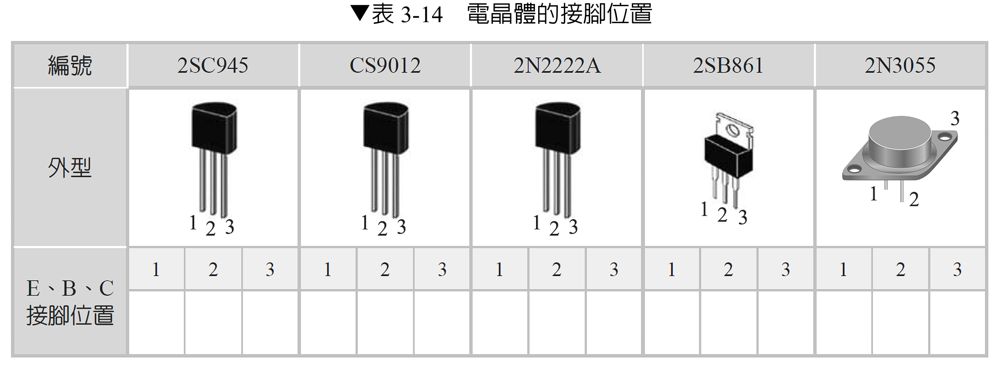

# 實習 3-3　射極（E）、基極（B）、集極（C）接腳之判別

> 原始教材：[實習3-3.pdf](實習3-3.pdf)　｜　建議課時：2 節

## 一、學習目標

完成本實習後，學生應能：

1. 先用接面測試找出基極並判斷 NPN 或 PNP。
2. 使用指針表 R×1 kΩ 檔及手指電阻，比較兩種 C、E 假設下的電流增益現象。
3. 由較大的 LI 偏轉判斷較可能的正確 C、E 方向。
4. 說明此傳統方法的物理原理、限制與不確定性。
5. 以製造商資料手冊作為接腳判斷的最終依據。

## 二、器材與元件

| 類別 | 品名 | 數量 |
|---|---|---:|
| 元件 | 2SC945、CS9012、2N2222A、2SB861、2N3055 | 各 1 |
| 儀器 | 指針三用電表，具 R×1 kΩ 檔 | 1 |
| 資料 | 對應製造商資料手冊 | 各 1 |
| 其他 | 元件盒、標籤紙、清潔紙 | 1 組 |

## 三、實習知識

> 以下為原文填空題目，請於實作前先自行完成。

1. 假設 **NPN** 型電晶體集極(C)與射極(E)接腳後，將三用電表黑棒接於假設的集極(C)，紅棒接於假設的射極(E)後，以手指當作電阻接於基極(B)與集極(C)之間，再記錄 LI 的刻度值。再將先前假設的集極(C)與射極(E)接腳對調後，將三用電表黑棒接於假設的集極(C)，紅棒接於假設的射極(E)後，以手指當作電阻接於基極(B)與集極(C)之間，再記錄 LI 的刻度值。比較兩次 LI 刻度值，較大者為假設 **正確**。

2. 假設 **PNP** 型電晶體集極(C)與射極(E)接腳後，將三用電表黑棒接於假設的射極(E)，紅棒接於假設的集極(C)後，以手指當作電阻接於基極(B)與集極(C)之間，再記錄 LI 的刻度值。再將先前假設的集極(C)與射極(E)接腳對調後，將三用電表黑棒接於假設的射極(E)，紅棒接於假設的集極(C)後，以手指當作電阻接於基極(B)與集極(C)之間，再記錄 LI 的刻度值。比較兩次 LI 刻度值，較大者為假設 **正確**。

## 四、先備條件

進行本節前，每顆元件必須先完成 `實習3-2`：

- 找到基極 B。
- 判斷 NPN 或 PNP。
- 確認 B-E、B-C 都是單向導通。
- 確認基極懸空時 C-E 沒有明顯短路。

若元件已損壞，或基極與類型尚未確認，不可進入 C、E 比較。

## 五、工作原理

### 4-1　為什麼 C、E 對調後仍可能有電流

BJT 的 B-E 與 B-C 都是 PN 接面，所以只看二極體導通方向通常容易找到基極，卻不一定能可靠區分 C 與 E。實際結構中，射極與集極的摻雜濃度、面積及幾何結構不同：

- 正常接法時，由基極電流控制的集極電流較大，電流增益較高。
- C、E 對調後，元件可能仍有作用，但反向電流增益通常明顯較低。

因此可建立兩種 C、E 假設，以手指電阻提供很小的基極電流，比較電表負載電流 LI 的偏轉大小；偏轉較大的方向通常是正確接法。

### 4-2　手指電阻的作用

手指跨接 B 與假設的 C，人體電阻形成一條很弱且不穩定的基極偏壓路徑：

> IB ≈ 測試電壓／手指與接面形成的等效電阻
>
> IC ≈ hFEIB

LI 刻度代表電表在該電阻檔所對應的負載電流指示。兩次量測若手指接觸方式近似相同，較大的偏轉表示較高的有效電流增益。

> **限制：** 手指電阻會受皮膚乾濕、壓力、接觸面積、溫度與電表內部電池影響。本方法只適合課堂比較，不是精密 hFE 測量，也不能取代資料手冊。

### 4-3　NPN 與 PNP 的儀表極性

本教材以常見指針表 R×1 kΩ 檔「黑棒為內部正端、紅棒為內部負端」為前提：

| 類型 | 電表黑棒 | 電表紅棒 | 手指電阻位置 |
|---|---|---|---|
| NPN | 假設 C | 假設 E | B 與假設 C 之間 |
| PNP | 假設 E | 假設 C | B 與假設 C 之間 |

若所用電表電阻檔極性不同，必須依實際極性反向配置。開始前應以已知二極體確認。

下圖以 NPN 與 PNP 對照方式，說明手指跨接法判別 C、E 接腳之工作原理、電表測試棒極性配置與偏壓電流回路（含 IB、IC、IE 導向），以及四步驟判斷原則：

## 六、安全與量測規範

- 元件必須完全斷電、離開帶電電路；不可把人體當作通電電路的測試元件。
- 指針表先設 R×1 kΩ，短接兩棒完成 0 Ω 歸零；不得使用高測試電流檔長時間量測小訊號元件。
- 手指只接觸指定的 B、C 接腳，不可同時碰觸其他導體或外部電源。
- 兩次比較必須使用相同檔位、相近接觸位置、壓力與時間；每次只讀取短時間穩定偏轉，不要長時間按住。
- 功率電晶體的金屬外殼可能是 C；測試前確認外殼與腳位定義。
- 若指針突然滿刻度、無法回零、元件或電表異常，立即移開測試棒。

## 七、實習一：NPN 型電晶體的 C、E 判別

### 6-1　建立假設 A

1. 從 `實習3-2` 的結果確認 B 與 NPN 類型。
2. 將剩餘兩腳任選一腳假設為 C，另一腳假設為 E。
3. 在已確認黑棒為正的 R×1 kΩ 檔，黑棒接假設 C，紅棒接假設 E。
4. 先不要碰基極，記錄基極懸空時的偏轉；應接近不導通。
5. 以同一隻手指輕觸 B 與假設 C，短時間讀取 LI 刻度，記為假設 A。

### 6-2　建立假設 B

1. 移開測試棒與手指，將先前假設的 C、E 完全對調。
2. 黑棒仍接新的假設 C，紅棒接新的假設 E。
3. 以相同手指、接觸面積與時間跨接 B 和新的假設 C。
4. 記錄 LI 刻度，記為假設 B。
5. A、B 中偏轉較大者通常是正確 C、E 方向；最後查資料手冊驗證。

## 八、實習二：PNP 型電晶體的 C、E 判別

### 7-1　建立假設 A

1. 從 `實習3-2` 的結果確認 B 與 PNP 類型。
2. 將剩餘兩腳任選一腳假設為 C，另一腳假設為 E。
3. 在已確認黑棒為正的 R×1 kΩ 檔，黑棒接假設 E，紅棒接假設 C。
4. 先記錄基極懸空偏轉，再以手指跨接 B 與假設 C，記錄 LI 刻度。

### 7-2　建立假設 B

1. 移開測試棒與手指，將 C、E 假設對調。
2. 黑棒接新的假設 E，紅棒接新的假設 C。
3. 以相同方式跨接 B 與假設 C，記錄第二次 LI 偏轉。
4. 偏轉較大的方向通常是正確 C、E 方向；最後查資料手冊驗證。

## 九、量測紀錄

### 8-1　C、E 假設比較

| 元件 | 類型 | B 腳號 | 假設 | 假設 C 腳號 | 假設 E 腳號 | 基極懸空 LI | 手指接入 LI | 偏轉大小 | 判定 |
|---|---|---:|---|---:|---:|---:|---:|---|---|
|  | NPN／PNP |  | A |  |  |  |  | 大／小 |  |
|  | NPN／PNP |  | B |  |  |  |  | 大／小 |  |

### 8-2　所有元件接腳結果

| 編號 | NPN／PNP | 外型定位方式 | 1 腳 | 2 腳 | 3 腳／外殼 | 較大 LI 的假設 | 資料手冊結果 | 是否一致 |
|---|---|---|---|---|---|---|---|---|
| 2SC945 |  |  |  |  |  |  |  |  |
| CS9012 |  |  |  |  |  |  |  |  |
| 2N2222A |  |  |  |  |  |  |  |  |
| 2SB861 |  |  |  |  |  |  |  |  |
| 2N3055 |  |  |  |  |  |  |  |  |

> **記錄原則：** `1、2、3` 必須配合實物的觀察方向。例如 TO-92 應註明平面朝向自己或背向自己；TO-3 應註明頂視圖或底視圖。沒有觀察方向的接腳答案是不完整的。

## 十、結果判讀與可信度

每顆元件依下列順序判定：

1. 兩種假設的基極懸空讀值都應接近截止；若不是，先檢查元件好壞。
2. 比較手指接入後的 LI 偏轉，較大者列為實驗判定。
3. 若兩者差異很小，清潔接腳、重新歸零並重複至少三次。
4. 若多次結果仍不一致，記錄為「無法可靠判定」，不可強行選答案。
5. 以完整料號、製造商、封裝與資料手冊接腳圖作最終確認。

| 元件 | 第 1 次 A／B | 第 2 次 A／B | 第 3 次 A／B | 重複性 | 最終處置 |
|---|---:|---:|---:|---|---|
|  |  |  |  | 一致／不一致 | 採用／查表確認／重測 |

## 十一、常見錯誤與排除方式

| 現象 | 常見原因 | 排除方式 |
|---|---|---|
| 兩種假設都沒有偏轉 | 基極錯誤、棒極性錯誤、皮膚過乾或元件開路 | 回到 3-2 重找 B，確認電表極性並查資料手冊 |
| 兩種假設都滿刻度 | C-E 短路、檔位錯誤或手指碰到其他接腳 | 移開手指量 C-E，重新歸零與檢查元件 |
| 每次比較結果不同 | 手指阻值與接觸壓力不一致 | 固定接觸方式，重複三次並記錄差異 |
| 實驗判定與資料手冊相反 | 觀察視角顛倒或型號／封裝不符 | 核對 Front／Bottom View、完整料號與廠牌 |
| 功率電晶體無法用 1、2、3 直接描述 | 外殼是第三端子 | 在表格明寫「外殼 = C」等資料手冊結果 |

## 十二、完成檢核

- [ ] 每顆元件均已先完成基極、類型與好壞判斷。
- [ ] 指針表 R×1 kΩ 檔已歸零，且測試棒實際極性已確認。
- [ ] NPN、PNP 分別使用正確的測試棒方向。
- [ ] 兩種 C、E 假設均在相同條件下量測，並記錄基極懸空與手指接入讀值。
- [ ] 差異不明顯者已重複量測，未強行判定。
- [ ] 所有結果均標示實物觀察方向並以資料手冊驗證。
- [ ] 實習結束後電表已離開 Ω 檔並完成元件收納。
