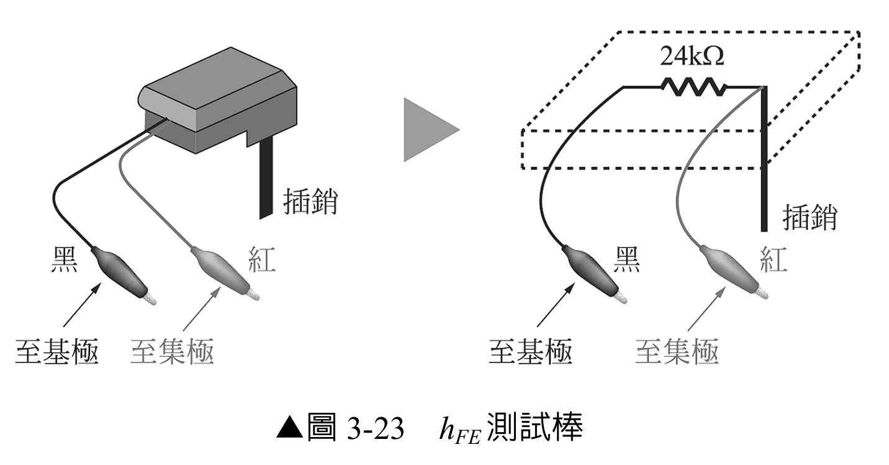
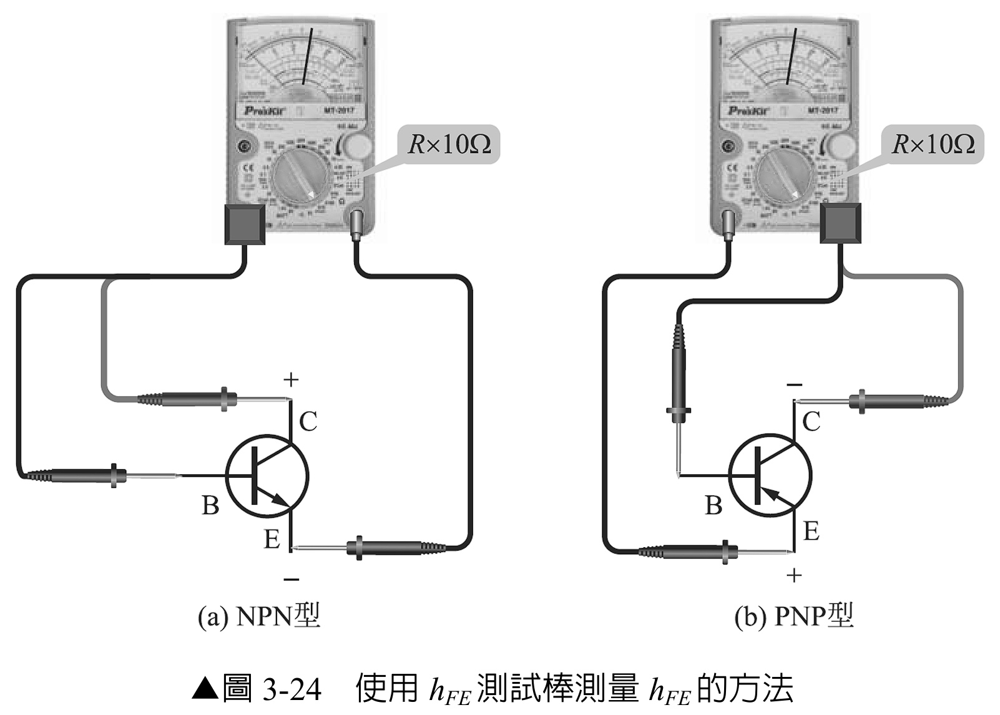
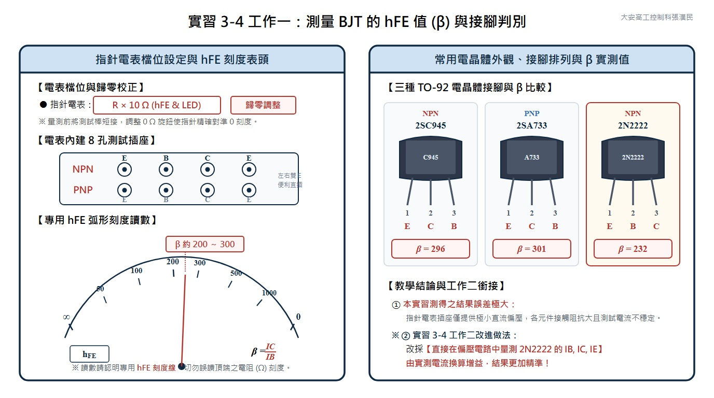
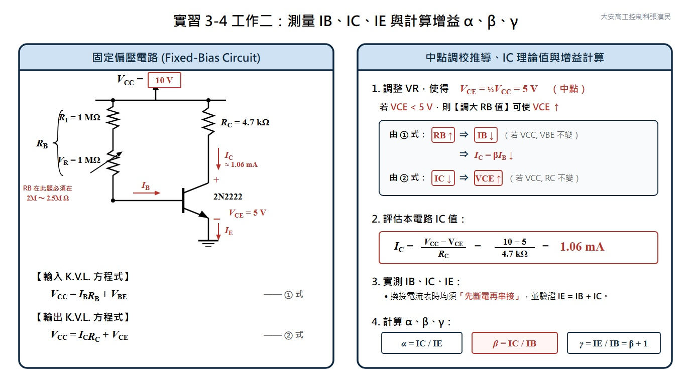
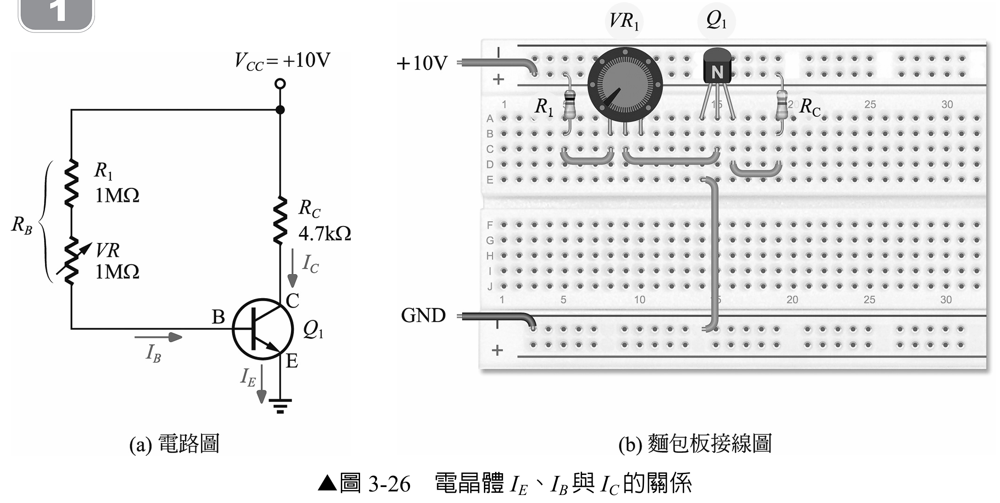
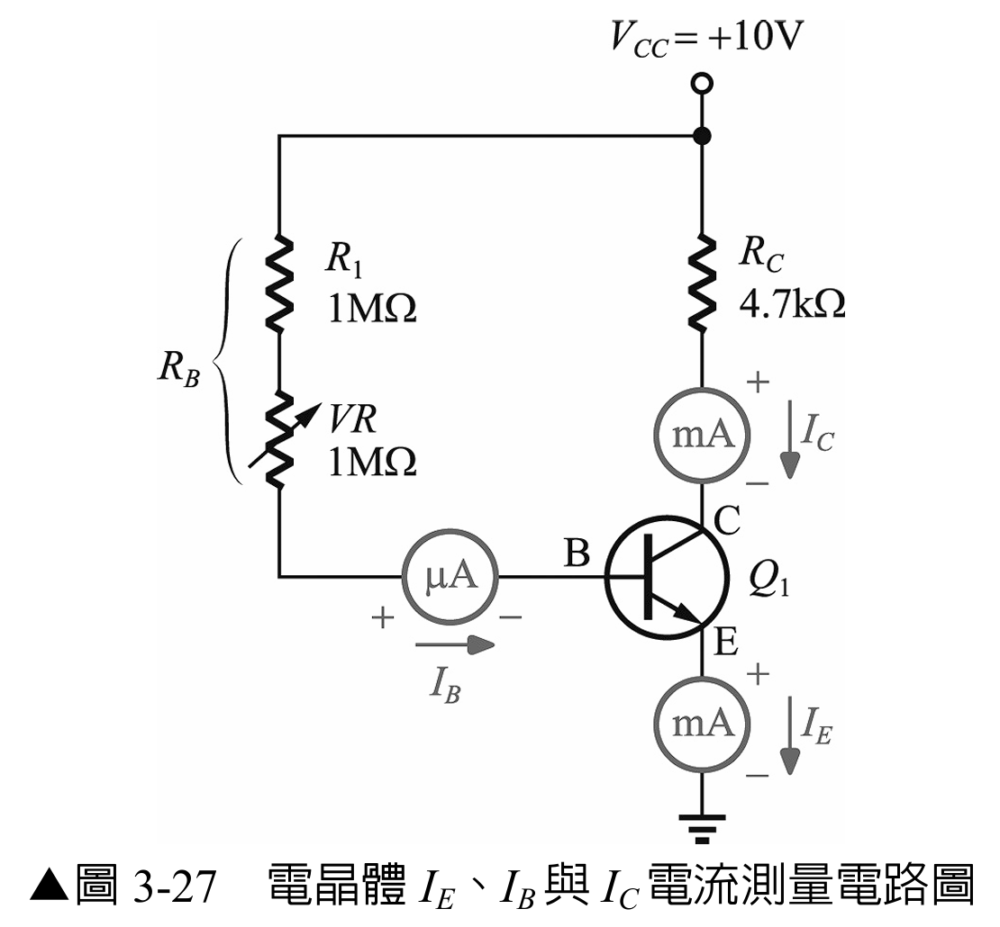

# 實習 3-4　IE、IB、IC 之關係與 hFE 值測量

> 原始教材：[實習3-4.pdf](實習3-4.pdf)　｜　建議課時：3 節

## 一、學習目標

完成本實習後，學生應能：

1. 說明 BJT 截止區、主動區與飽和區的接面偏壓條件。
2. 驗證 IE = IB + IC。
3. 計算共基極、共射極與共集極電流增益 α、β、γ。
4. 使用外接 hFE 測試棒及電表內建測試座量測直流電流增益。
5. 比較不同量測方法、工作電流及資料手冊 hFE 範圍的差異。

## 二、器材與元件

| 類別 | 品名與規格 | 數量 |
|---|---|---:|
| 電源 | 10 V 可調式直流電源供應器 | 1 |
| 元件 | 2SC945、CS9012、2N2222A | 各 1 |
| 元件 | 1 MΩ 電阻 R1 | 1 |
| 元件 | 1 MΩ 可變電阻 VR | 1 |
| 元件 | 4.7 kΩ 集極電阻 RC | 1 |
| 儀器 | 指針三用電表與 hFE 測試棒 | 1 組 |
| 儀器 | 具 hFE 測試座的指針或數位萬用電表 | 1 |
| 儀器 | μA／mA 電流表、DCV 電壓表 | 依現場配置 |
| 其他 | 麵包板與接線 | 1 組 |

## 三、實習知識

> 以下為原文填空題目，請於實作前先自行完成。

1. 電晶體的工作區域：

| 項目 | 基-射極(B-E)接面 | 集-基極(C-B)接面 | 主要功用 |
|---|---|---|---|
| 飽和區(saturation) | **\_\_\_\_\_\_\_\_\_\_** | **\_\_\_\_\_\_\_\_\_\_** | 開關電路(ON) |
| 主動區(active) | **\_\_\_\_\_\_\_\_\_\_** | **\_\_\_\_\_\_\_\_\_\_** | 放大信號 |
| 截止區(cut off) | **\_\_\_\_\_\_\_\_\_\_** | **\_\_\_\_\_\_\_\_\_\_** | 開關電路(OFF) |

2. 電晶體 E、B、C 極之間電流的關係為 **\_\_\_\_\_\_\_\_\_\_**。

3. 電晶體電流增益的定義為 α = **\_\_\_\_\_\_\_\_\_\_**，β = **\_\_\_\_\_\_\_\_\_\_**，γ = **\_\_\_\_\_\_\_\_\_\_**。

## 四、工作原理

### 3-1　BJT 的工作區

| 工作區 | B-E 接面 | C-B 接面 | 主要用途 |
|---|---|---|---|
| 截止區 Cutoff | 反向偏壓或未達導通 | 反向偏壓 | 開關 OFF |
| 主動區 Active | 順向偏壓 | 反向偏壓 | 線性放大 |
| 飽和區 Saturation | 順向偏壓 | 順向偏壓 | 開關 ON |

主動區中的矽 NPN 電晶體，VBE 常約 0.6–0.8 V，但實際值會隨電流與溫度改變。當 VCE 已很低且兩個接面都順向偏壓時，元件進入飽和區，IC 不再簡單等於 βIB。

### 3-2　三個端子的電流關係

依節點電流定律：

> IE = IB + IC

由於 IB 通常遠小於 IC，所以 IE 與 IC 很接近，但不能直接視為完全相等。

### 3-3　三種電流增益

| 名稱 | 符號 | 定義 | 常見大小 |
|---|---|---|---|
| 共基極電流增益 | α | IC／IE | 小於 1，通常接近 1 |
| 共射極電流增益 | β 或 hFE | IC／IB | 通常遠大於 1 |
| 共集極電流增益 | γ | IE／IB | β + 1 |

三者關係為：

> α = β／(β + 1)
>
> β = α／(1 − α)
>
> γ = β + 1 = 1／(1 − α)

### 3-4　hFE 不是固定常數

hFE 會隨 IC、VCE、溫度與元件個體改變。電表測試座通常在特定且未必標示清楚的小電流條件下測量，因此：

- 同一顆元件用不同電表可能得到不同值。
- 同型號不同顆元件可能差異很大。
- 資料手冊範圍只有在指定測試條件下才成立。
- hFE 測值可用於分類或檢查，不宜當作精密設計常數。

## 五、安全與儀表規範

> **警告：** 直流電源必須先關閉輸出並設定電流上限。本實驗 VCC = 10 V、RC = 4.7 kΩ，集極支路理論最大值約 2.1 mA；建議電源電流上限先設為 5 mA。若總電流明顯超過預期、電晶體升溫或讀值不穩，立即關閉輸出。

- 電流表必須串聯，不得直接跨接電源或元件兩端。
- 插拔電晶體、hFE 測試座、測試棒或更換電流表位置前，必須先關閉輸出。
- 電流表先用較高量程，再逐步換至適合量程；IB 通常使用 μA 檔，IC、IE 通常使用 mA 檔。
- 使用多支電表同時量測時，各表的內阻會稍微改變工作點；須在報告中說明這項負載效應。
- 所有 E、B、C 接腳與 NPN／PNP 類型必須先由 `實習3-1` 至 `實習3-3` 確認。

## 六、實習一：使用 hFE 測試棒

### 5-1　測試棒結構

原教材測試棒內部使用 24 kΩ 電阻，使基極獲得有限測試電流。黑色測試夾接 B，紅色測試夾接 C，插腳連接三用電表。

> **教材核對提醒：** 原文字步驟標示 `R×10 kΩ`，圖 3-24 儀表旁的標示則呈現 `R×10 Ω`，兩處不一致。實際操作必須以現場電表及該測試棒的使用說明、教師確認的檔位與 hFE 刻度為準，不可僅憑其中一處標示通電量測。

### 5-2　NPN 與 PNP 的量測

1. 確認元件類型、好壞及 E、B、C 接腳。
2. 電表切至教師確認的指定電阻檔，短接測試棒並完成 0 Ω 歸零。
3. 黑色測試夾接 B，紅色測試夾接 C。
4. NPN：依測試棒說明插入電表指定端，再將黑色電表測試棒接 E。
5. PNP：反轉測試棒與電表端的極性，再依圖將黑色電表測試棒接 E。
6. 待指針穩定後直接讀取 hFE 專用刻度；不可把 Ω 刻度直接當成 hFE。
7. 量測後立即移開測試棒，避免長時間施加偏壓。

## 七、實習二：使用電表內建 hFE 測試座

### 6-1　測試座操作與判讀要領

1. **電表檔位與歸零**：指針電表切至 `R×10 Ω (hFE & LED)` 檔，兩表棒短接進行 `0 Ω ADJ` 歸零調整。
2. **極性與插孔排列**：確認電表面板上的專用測試插座，區分 NPN 與 PNP 區域（各有 `E-B-C-E` 插孔）。
3. **電晶體接腳判別**：不可僅依 TO-92 塑封外觀猜測接腳，不同型號腳位差異極大：
   - **2SC945 (NPN)**：正面平視由左至右為 1(E) - 2(C) - 3(B)，實測 $\beta \approx 296$。
   - **2SA733 (PNP)**：正面平視由左至右為 1(E) - 2(C) - 3(B)，實測 $\beta \approx 301$。
   - **2N2222 (NPN)**：正面平視由左至右為 1(E) - 2(B) - 3(C)，實測 $\beta \approx 232$。
4. **刻度讀取**：對齊面板弧形的 $h_{FE}$ 專用刻度（刻度標記通常為 50, 100, 200, 500, 1000），常見小訊號電晶體之 $\beta$ 值約落在 200 ～ 300 之間。
5. **量測限制與精準度提醒**：
   - 內建測試座在極微小的測試電流下運作，且受接觸阻抗與儀表非線性影響，**量測結果誤差通常較大**。
   - 在後續的實習三（工作二）中，將改採直接在直流偏壓電路中量測電晶體的 $I_B, I_C, I_E$，由實測電流換算增益，結果更加精準！

下圖彙整三用電表內建 $h_{FE}$ 測試座量測方法、指針刻度判讀，以及常用 NPN／PNP 電晶體之接腳與實測對照：

### 6-2　三種來源比較

| 元件 | 測試棒第 1 次 | 測試棒第 2 次 | 內建座第 1 次 | 內建座第 2 次 | 資料手冊 hFE 範圍 | 資料手冊測試條件 | 結果說明 |
|---|---:|---:|---:|---:|---|---|---|
| 2SC945 |  |  |  |  |  |  |  |
| CS9012 |  |  |  |  |  |  |  |
| 2N2222A |  |  |  |  |  |  |  |

## 八、實習三：量測 IE、IB、IC

### 7-1　固定偏壓電路中點調校原理與推導

在固定偏壓電路中，藉由調整基極可變電阻 VR，使集極中點電壓達到 $V_{CE} = \frac{V_{CC}}{2} = 5\text{ V}$，使電路具備對稱的最大不失真輸出動態範圍。

#### 1. 迴路 KVL 方程式
- **輸入迴路 KVL**：
  $$V_{CC} = I_B R_B + V_{BE} \quad \text{—— ①}$$
- **輸出迴路 KVL**：
  $$V_{CC} = I_C R_C + V_{CE} \quad \text{—— ②}$$

#### 2. 中點電壓調校方向邏輯推導
- 若通電後量得 $V_{CE} < 5\text{ V}$（工作點偏向飽和），必須**調大 $R_B$ 阻值**以使 $V_{CE} \uparrow$：
  $$\text{由 ① 式：} R_B \uparrow \implies I_B = \frac{V_{CC} - V_{BE}}{R_B} \downarrow \implies I_C = \beta I_B \downarrow$$
  $$\text{由 ② 式：} I_C \downarrow \implies V_{CE} = V_{CC} - I_C R_C \uparrow$$
- 在本實習電路（$V_{CC}=10\text{ V}, R_C=4.7\text{ k}\Omega$）中，$R_B$ 調整後之總阻值約在 $2\text{ M}\Omega \sim 2.5\text{ M}\Omega$。

#### 3. 集極電流評估
中點調校完成時（$V_{CE} = 5\text{ V}$），集極電流之理論評估值為：
$$I_C = \frac{V_{CC} - V_{CE}}{R_C} = \frac{10\text{ V} - 5\text{ V}}{4.7\text{ k}\Omega} \approx 1.06\text{ mA}$$

下圖整理固定偏壓電路中點調校推導、調校步驟，以及三電流與三增益（$\alpha, \beta, \gamma$）之計算架構：

### 7-2　接線與工作點調校步驟

1. 關閉電源，將 VR 調至最大電阻端，以減少初始 IB。
2. 依圖接妥 2N2222A、R1 = 1 MΩ、VR = 1 MΩ 與 RC = 4.7 kΩ。
3. 電源先設 0 V、電流上限 5 mA；接線複核後才可將 VCC 調至 10 V。
4. 使用 DCV 檔量測 VCE，緩慢調整 VR，使 VCE 約為 VCC／2 = 5 V。
5. 此時可先估算 IC ≈ (10 V − 5 V)／4.7 kΩ ≈ 1.06 mA，作為電流表量程與結果合理性檢查。

> **調整異常：** 若 VR 已在最大電阻端而 VCE 仍低於 5 V，表示基極電流可能仍過大，可在教師確認後增大 R1；若 VR 已在最小電阻端而 VCE 仍高於 5 V，可適度減小 R1。更換電阻前必須關閉電源。

### 7-3　三電流量測與增益計算

1. 關閉電源，在 B 支路串入 μA 表、C 與 E 支路分別串入 mA 表。
2. 檢查每支電流表正負極與插孔，先選較高量程。
3. 開啟輸出後重新確認 VCE；插入電流表後工作點可能改變，必要時微調 VR 回到約 5 V。
4. 同時記錄 IB、IC、IE 與 VCE，不要在通電狀態改變量程插孔。
5. 計算 IB + IC，比較其與 IE 的差值及百分比。
6. 計算 α、β、γ，並檢查 γ ≈ β + 1、α ≈ β／(β + 1)。

| VCC | VCE | IB | IC | IE | IB + IC | 差值 | 差異百分比 |
|---:|---:|---:|---:|---:|---:|---:|---:|
| 10 V |  |  |  |  |  |  |  |

| 增益 | 計算式 | 計算值 | 關係驗證 |
|---|---|---:|---|
| α | IC／IE |  | 應小於 1 |
| β | IC／IB |  | 與 hFE 比較 |
| γ | IE／IB |  | 應約為 β + 1 |

## 九、誤差與比較

| 誤差來源 | 對結果的影響 | 改善方式 |
|---|---|---|
| 電流表負擔電壓與內阻 | 改變原工作點 | 插表後重測 VCE，使用合適量程 |
| 元件溫度上升 | hFE 與 VBE 改變 | 縮短量測時間並等待溫度穩定 |
| VR 接觸與電阻公差 | IB 不穩 | 緩慢調整並重複量測 |
| 不同 hFE 測試電流 | 各方法讀值不同 | 同時記錄儀表、檔位與資料手冊測試條件 |
| 三支表未同時讀值 | 工作點隨時間漂移 | 先穩定工作點，再快速依序記錄 |

## 十、完成檢核

- [ ] 電源已設定 5 mA 電流上限，VR 由最大電阻端開始調整。
- [ ] 外接測試棒的檔位矛盾已依現場儀表說明確認。
- [ ] hFE 測試座的 NPN／PNP 與 E、B、C 孔位均正確。
- [ ] 三支電流表皆串聯且由較高量程開始。
- [ ] 已驗證 IE ≈ IB + IC 並計算 α、β、γ。
- [ ] hFE 比較表包含資料手冊測試條件，而非只抄數值。
- [ ] 實習結束後已關閉輸出並將 VR 恢復高阻值端。
