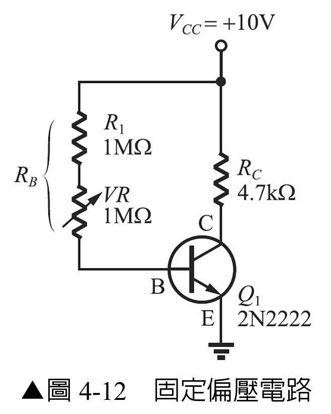
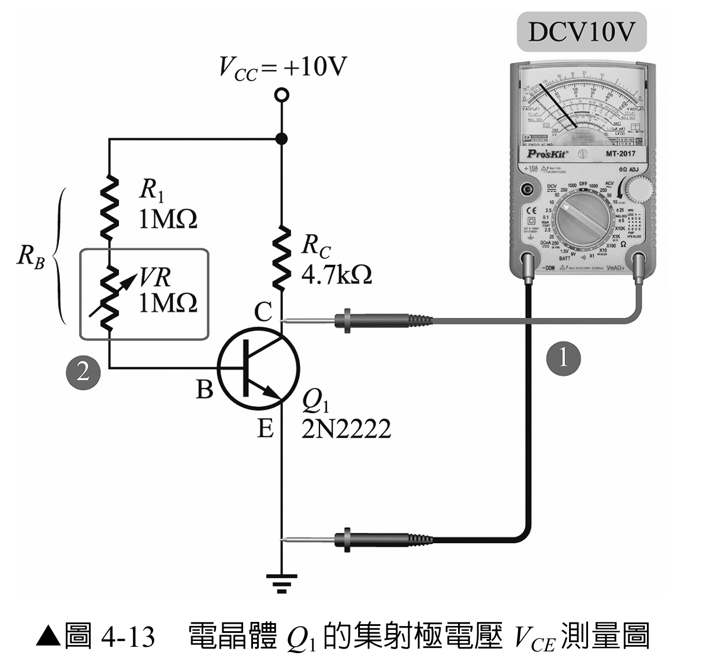
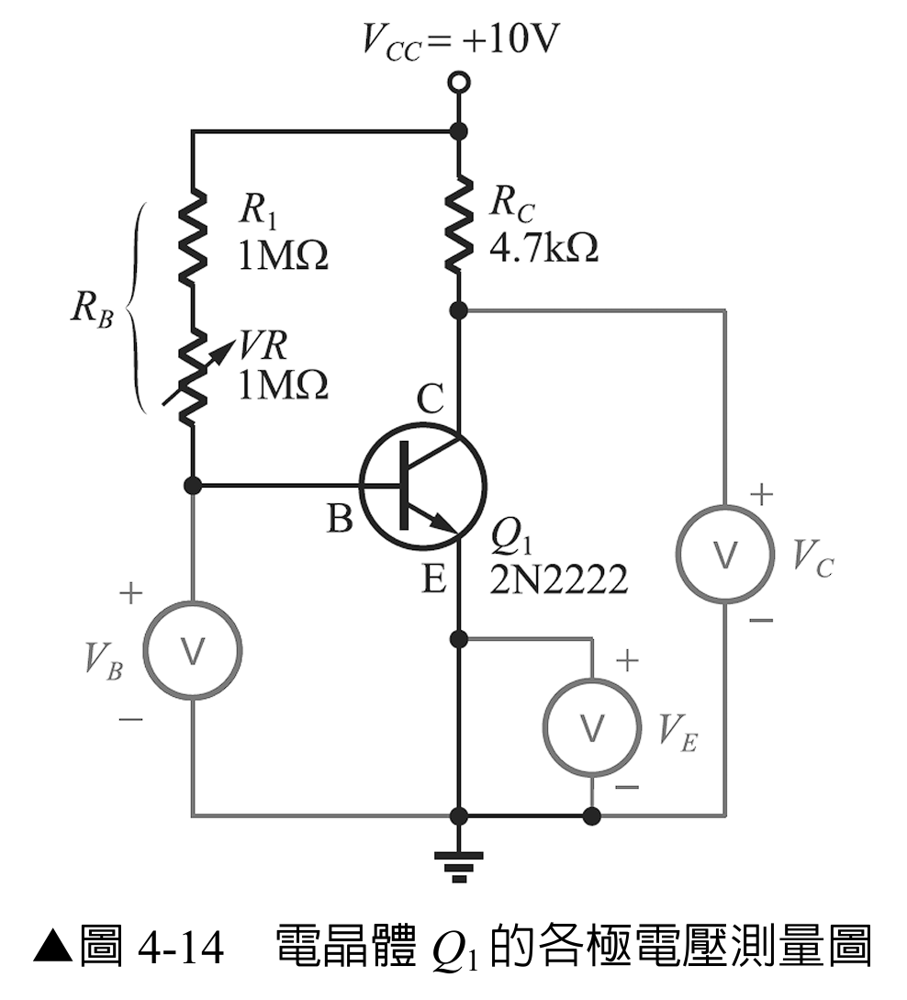
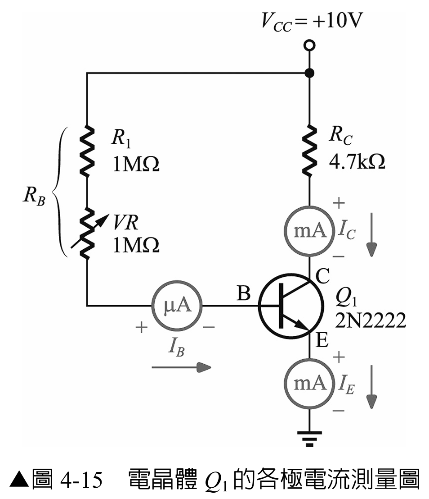
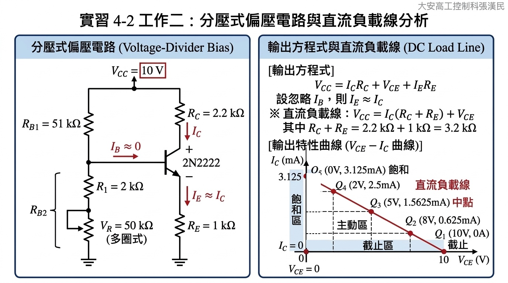
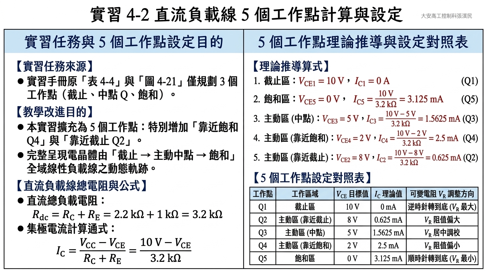
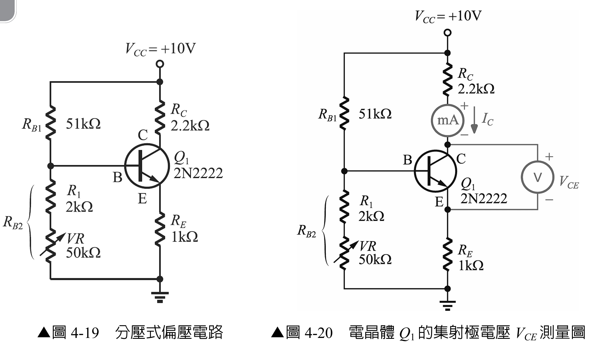
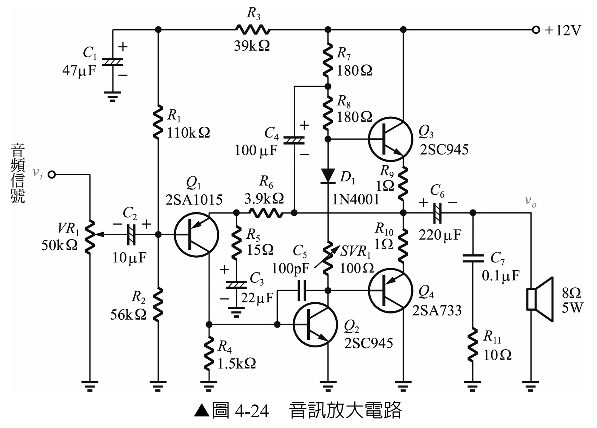
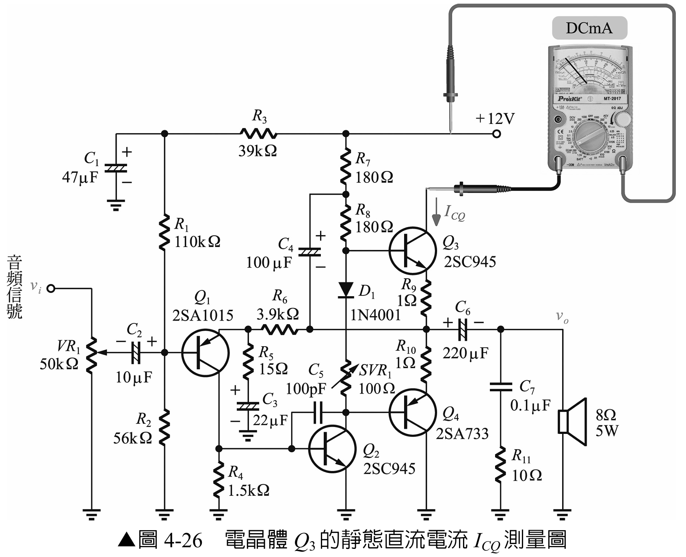

# 實習 4-2　電晶體偏壓與音訊放大器實作

> 原始教材：[實習4-2.pdf](實習4-2.pdf)　｜　建議課時：4–6 節

## 一、學習目標

完成本實習後，學生應能：

1. 分辨共射極、共集極與共基極電路的輸入端、輸出端及共同端。
2. 說明靜態工作點 Q、直流負載線、飽和與截止的意義。
3. 完成固定偏壓與分壓式偏壓電路，量測各端電壓及支路電流。
4. 比較固定偏壓與分壓式偏壓的工作點穩定特性。
5. 完成多級音訊放大器的接線、靜態調整與音源測試。

## 二、器材與元件

- 直流電源供應器、數位萬用電表、電晶體測試器或具 hFE 功能的電表。
- 麵包板、跳線、智慧型手機或 MP3 播放器、8 Ω／5 W 揚聲器。
- 2N2222、2SA1015、2SC945、2SA733、1N4001。
- 電阻、可變電阻及電容的數值依各工作電路圖配置。

> 元件腳位不可只依外形猜測。接線前須查閱實際廠牌的資料表，確認 B、C、E 腳及電解電容極性。

## 三、工作原理

### 3-1　三種基本接法

| 接法 | 共同端 | 輸入 | 輸出 | 主要特性 |
|---|---|---|---|---|
| 共射極 CE | 射極 | 基極—射極 | 集極—射極 | 具電壓與電流增益，輸出反相 |
| 共集極 CC | 集極 | 基極—集極 | 射極—集極 | 電壓增益接近 1，輸入阻抗高、輸出阻抗低 |
| 共基極 CB | 基極 | 射極—基極 | 集極—基極 | 電流增益接近 1，適合較高頻應用 |

### 3-2　靜態工作點與直流負載線

沒有交流輸入時，電路的直流電壓與電流稱為靜態值。Q 點通常以 I<sub>CQ</sub>、V<sub>CEQ</sub> 表示。若 Q 點太靠近截止區或飽和區，交流訊號的一側會提早削波。

> V<sub>CC</sub> = I<sub>C</sub>R<sub>C</sub> + V<sub>CE</sub> + I<sub>E</sub>R<sub>E</sub>

取 I<sub>E</sub> ≈ I<sub>C</sub> 時，負載線兩端點約為：

- 截止：I<sub>C</sub> = 0，V<sub>CE</sub> ≈ V<sub>CC</sub>。
- 飽和：V<sub>CE</sub> ≈ 0.2 V，I<sub>C</sub> ≈ (V<sub>CC</sub> − 0.2 V)／(R<sub>C</sub> + R<sub>E</sub>)。

### 3-3　固定偏壓

固定偏壓電路中，R<sub>B</sub> = R<sub>1</sub> + VR：

> I<sub>B</sub> = (V<sub>CC</sub> − V<sub>BE</sub>)／R<sub>B</sub>
>
> I<sub>C</sub> = βI<sub>B</sub>
>
> I<sub>E</sub> = I<sub>B</sub> + I<sub>C</sub>
>
> V<sub>C</sub> = V<sub>CC</sub> − I<sub>C</sub>R<sub>C</sub>

矽電晶體導通時常以 V<sub>BE</sub> ≈ 0.7 V 初估，但應以量測值完成計算。I<sub>C</sub> 直接受 β 與 V<sub>BE</sub> 影響，因此元件更換或溫度變化時，Q 點容易漂移。

### 3-4　分壓式偏壓

基極分壓網路可換算為戴維寧等效：

> V<sub>TH</sub> = V<sub>CC</sub>R<sub>B2</sub>／(R<sub>B1</sub> + R<sub>B2</sub>)
>
> R<sub>TH</sub> = R<sub>B1</sub> ∥ R<sub>B2</sub>

射極電阻形成直流負回授：I<sub>E</sub> 增加時，V<sub>E</sub> 上升，使 V<sub>BE</sub> 及基極電流下降，抵銷原來的增加。因此分壓式偏壓通常比固定偏壓穩定。教材以 R<sub>in</sub> ≈ (1 + β)R<sub>E</sub> 說明基極輸入效應；當 R<sub>in</sub> 遠大於分壓器下臂電阻時，Q 點較不受 β 影響。

### 3-5　音訊放大器各級

圖 4-24 是單電源、電容耦合輸出的多級音訊放大器。它不是由某一顆電晶體單獨完成全部放大，而是把電壓增益、驅動能力與負載電流分配給不同級。整體訊號路徑為：

```text
音源 → VR1 音量控制 → C2 輸入耦合 → Q1 前級
     → Q2 電壓放大／驅動 → Q3、Q4 互補輸出級
     → C6 輸出耦合 → 8 Ω 揚聲器
```

Q<sub>1</sub>、Q<sub>2</sub> 主要建立電壓增益並提供輸出級所需的驅動訊號；Q<sub>3</sub>、Q<sub>4</sub> 主要提高可供給低阻抗揚聲器的電流。D<sub>1</sub> 與 SVR<sub>1</sub> 設定互補輸出級的靜態偏壓，使其工作接近 AB 類，以降低交越失真。C<sub>6</sub> 隔離輸出級的直流中點電壓，只讓音頻交流送到揚聲器。

## 四、安全與操作規範

1. 接線、換檔、移動電流表及調整電阻量測方式前，必須關閉電源輸出。
2. 電源供應器必須設定電流上限。偏壓實驗先採低電流限制；音訊電路無訊號檢查可先設約 100 mA，確認正常後才依教師指示與元件額定值調整。
3. VR 與 SVR 應由可使電流較小的方向開始緩慢調整；不確定滑動端位置時，先斷電以電阻檔確認。
4. 不可在通電狀態直接把電流表跨接於電源或元件兩端。量測電流須先斷電、切開支路，再將電流表串聯。
5. 若限流指示亮起、元件發熱、出現異味、揚聲器異常作響或量測值明顯偏離預期，立即關閉輸出。
6. 音訊放大器在中點電壓與靜態電流確認前，不接音源與揚聲器；電解電容極性錯誤時不得送電。

## 五、工作一：固定偏壓電路



1. 斷電量測 2N2222 的 β 並記錄；再確認 B、C、E 腳位。
2. 將 VR 先調至使 R<sub>B</sub> 最大，依圖 4-12 接線。V<sub>CC</sub> = 10 V、R<sub>1</sub> = 1 MΩ、VR = 1 MΩ、R<sub>C</sub> = 4.7 kΩ。
3. 教師檢查後開啟輸出，緩慢調整 VR，使 V<sub>CE</sub> = V<sub>CC</sub>／2 ≈ 5 V。



依序量測 V<sub>B</sub>、V<sub>C</sub>、V<sub>E</sub>。量測 I<sub>B</sub>、I<sub>C</sub>、I<sub>E</sub> 時，每次均先斷電再改接電流表。




完成通電量測後關閉輸出，將相關元件至少一端與電路隔離，再量測 R<sub>B</sub> 與 R<sub>C</sub>，避免其他支路造成誤差。

| 項目 | 理論值 | 量測值 | 誤差或說明 |
|---|---:|---:|---|
| β | — |  |  |
| R<sub>B</sub> | — |  | R<sub>1</sub> + VR |
| R<sub>C</sub> | 4.7 kΩ |  |  |
| V<sub>B</sub> |  |  |  |
| V<sub>C</sub> |  |  |  |
| V<sub>E</sub> | 0 V |  |  |
| V<sub>CE</sub> | 約 5 V |  |  |
| I<sub>B</sub> |  |  |  |
| I<sub>C</sub> |  |  |  |
| I<sub>E</sub> |  |  | 檢查 I<sub>E</sub> ≈ I<sub>B</sub> + I<sub>C</sub> |

## 六、工作二：分壓式偏壓電路與直流負載線

### 6-1　實作前分析與直流負載線推導

分壓式偏壓電路藉由 R<sub>B1</sub> 與 R<sub>B2</sub> 分壓提供穩定的基極電壓，並由射極電阻 R<sub>E</sub> 引入直流負回授以穩定工作點。

由輸出迴路的克希荷夫電壓定律（KVL）：

> V<sub>CC</sub> = I<sub>C</sub>R<sub>C</sub> + V<sub>CE</sub> + I<sub>E</sub>R<sub>E</sub>

因為電晶體電流增益 β ≫ 1，基極電流極微小（I<sub>B</sub> ≈ 0），可視為 I<sub>E</sub> ≈ I<sub>C</sub>，整理得直流負載線（DC Load Line）方程式：

> V<sub>CC</sub> = I<sub>C</sub>(R<sub>C</sub> + R<sub>E</sub>) + V<sub>CE</sub>
> 
> I<sub>C</sub> = (V<sub>CC</sub> − V<sub>CE</sub>)／(R<sub>C</sub> + R<sub>E</sub>)

代入本實習電路數值：V<sub>CC</sub> = 10 V、R<sub>C</sub> = 2.2 kΩ、R<sub>E</sub> = 1 kΩ，總負載電阻 R<sub>dc</sub> = R<sub>C</sub> + R<sub>E</sub> = 3.2 kΩ：

- **縱軸截距（飽和電流）**：當 V<sub>CE</sub> = 0 V 時，I<sub>C(sat)</sub> = 10 V／3.2 kΩ = 3.125 mA。
- **橫軸截距（截止電壓）**：當 I<sub>C</sub> = 0 A 時，V<sub>CE(cutoff)</sub> = V<sub>CC</sub> = 10 V。

下圖整理分壓式偏壓電路之完整接線、偏壓電流方向、輸出 KVL 推導，以及在輸出特性曲線（V<sub>CE</sub>–I<sub>C</sub>）上繪出之直流負載線與 5 個代表性工作點（Q<sub>1</sub>～Q<sub>5</sub>）：



### 6-2　實習任務：5 個工作點之理論計算

原始實習手冊（表 4-4 與圖 4-21）僅規劃了 3 個工作點（截止點、中點 Q、飽和點）。為了能完整觀察並驗證直流負載線在全主動放大區的線性變化軌跡，本實習將量測任務**擴充為 5 個工作點**，特別增加「靠近飽和 Q<sub>4</sub> (2 V)」與「靠近截止 Q<sub>2</sub> (8 V)」。

各工作點之理論值推導如下：

1. **截止區 (Q<sub>1</sub>)**：V<sub>CE1</sub> = 10 V，I<sub>C1</sub> = 0 A。
2. **飽和區 (Q<sub>5</sub>)**：V<sub>CE5</sub> = 0 V（實際量測約 0.1～0.2 V），I<sub>C5</sub> = 10 V／3.2 kΩ = 3.125 mA。
3. **主動區中點 (Q<sub>3</sub>)**：V<sub>CE3</sub> = 5 V（½V<sub>CC</sub>），I<sub>C3</sub> = (10 − 5) V／3.2 kΩ = 1.5625 mA（動態範圍最大之最佳 Q 點）。
4. **主動區靠近飽和 (Q<sub>4</sub>)**：V<sub>CE4</sub> = 2 V，I<sub>C4</sub> = (10 − 2) V／3.2 kΩ = 2.5 mA。
5. **主動區靠近截止 (Q<sub>2</sub>)**：V<sub>CE2</sub> = 8 V，I<sub>C2</sub> = (10 − 8) V／3.2 kΩ = 0.625 mA。

下圖呈現 5 個工作點的教學目的、理論推導算式，以及 VR 調整方向對照表：



### 6-3　接線與量測步驟



1. 關閉電源輸出，將多圈式可變電阻 VR (50 kΩ) 調至使基極電位最低的方向（逆時針轉到底）。
2. 依圖 4-19 接線：V<sub>CC</sub> = 10 V、R<sub>B1</sub> = 51 kΩ、R<sub>B2</sub> = R<sub>1</sub> (2 kΩ) + VR (50 kΩ 多圈式)、R<sub>C</sub> = 2.2 kΩ、R<sub>E</sub> = 1 kΩ、電晶體為 2N2222。
3. 檢查無誤後送電，依序微調 VR，使 V<sub>CE</sub> 穩定達到 10 V、8 V、5 V、2 V、0 V（約 0.2 V）等 5 個目標工作點。
4. 於各工作點量測 V<sub>B</sub>、V<sub>C</sub>、V<sub>E</sub>、V<sub>CE</sub>，並計算實測電流 I<sub>E</sub> ≈ V<sub>E</sub>／R<sub>E</sub> 及 I<sub>C</sub> ≈ (V<sub>CC</sub> − V<sub>C</sub>)／R<sub>C</sub>，記錄於下表。
5. 將 5 個實測工作點（V<sub>CE</sub>, I<sub>C</sub>）描繪於座標紙或圖 4-21 直流負載線上，檢驗其是否連成一直線。

▼ 表 4-4（擴充版）：分壓式偏壓電路 5 個工作點量測與理論比較表

| 工作點 | 工作區域 | 目標 V<sub>CE</sub> | 理論 I<sub>C</sub> | VR 調整指引 | 實測 V<sub>CE</sub> | 實測 I<sub>C</sub> | 負載線位置 |
|:---:|---|---:|---:|---|---:|---:|---|
| Q<sub>1</sub> | 截止區 | 10 V | 0 mA | 逆時針轉到底（V<sub>B</sub> 最小） |  |  | 橫軸截距 |
| Q<sub>2</sub> | 主動區（靠近截止） | 8 V | 0.625 mA | 由截止點微調增大 V<sub>B</sub> |  |  | 負載線右段 |
| Q<sub>3</sub> | 主動區（正中點） | 5 V | 1.5625 mA | 居中調校（V<sub>CE</sub> ≈ ½V<sub>CC</sub>） |  |  | 負載線中點 |
| Q<sub>4</sub> | 主動區（靠近飽和） | 2 V | 2.5 mA | 繼續調大基極偏壓 |  |  | 負載線左段 |
| Q<sub>5</sub> | 飽和區 | 0 V (≈0.2 V) | 3.125 mA | 順時針轉到底（V<sub>B</sub> 最大） |  |  | 縱軸截距 |


## 七、工作三：音訊放大電路

先依實際元件資料表填寫腳位；不同廠牌或封裝可能不同。

| 元件 | 型別 | 腳 1 | 腳 2 | 腳 3 | 查核來源 |
|---|---|---|---|---|---|
| 2SA733 | PNP |  |  |  |  |
| 2SA1015 | PNP |  |  |  |  |
| 2SC945 | NPN |  |  |  |  |



### 7-1　電路工作原理

#### （一）輸入音量、耦合與前級偏壓

VR<sub>1</sub> 接成可變分壓器。滑動端取出的音源比例送往 C<sub>2</sub>；VR<sub>1</sub> 越靠近接地端，送入放大器的交流振幅越小。它控制的是輸入訊號，不是電源電壓。

C<sub>2</sub> 為輸入耦合電容，可阻隔手機或訊號源可能帶有的直流分量，避免外部直流改變 Q<sub>1</sub> 的偏壓。R<sub>1</sub>、R<sub>2</sub> 及周圍電阻網路建立 Q<sub>1</sub> 的直流工作條件；R<sub>3</sub> 與 C<sub>1</sub> 對前級偏壓電源提供隔離與濾波，減少輸出級的大電流變化經電源線回授至前級而產生低頻振盪或雜聲。

耦合電容與它所看到的等效電阻形成高通網路。一般形式為：

> f<sub>L</sub> ≈ 1／(2πR<sub>eq</sub>C)

因此電容量過小時，低頻訊號會先被衰減；但 R<sub>eq</sub> 是電容兩側電路的等效電阻，不能只取圖上的某一顆電阻。

#### （二）電壓放大與驅動級

Q<sub>1</sub> 接收 C<sub>2</sub> 送入的小音頻訊號，Q<sub>2</sub> 再把前級的電壓變化轉換成能驅動上下輸出電晶體的訊號。這兩級決定大部分開迴路電壓增益；R<sub>4</sub>、R<sub>5</sub>、R<sub>6</sub> 與 C<sub>3</sub> 同時參與偏壓、局部回授及交流增益的設定。

由輸出中點返回前級的 R<sub>6</sub> 路徑具有負回授作用：輸出中點若因元件差異或溫度而偏移，回授會改變前級導通程度，將中點拉回設計位置。對交流訊號而言，適量負回授也可降低失真、穩定增益並擴大有效頻寬。實際閉迴路增益由多個元件共同決定，不宜只用單一 R<sub>C</sub>／R<sub>E</sub> 公式估算整機增益。

C<sub>5</sub> = 100 pF 為高頻補償電容，使高頻開迴路增益提早下降，以提高負回授迴路的穩定度。它不是音頻耦合電容，任意加大可能使高頻響應過度衰減；漏接或佈線過長則可能增加高頻自激風險。

#### （三）互補輸出級與 AB 類偏壓

Q<sub>3</sub> 為 NPN、Q<sub>4</sub> 為 PNP，構成互補推挽輸出級。正半週主要由上側 Q<sub>3</sub> 向負載方向供應電流，負半週主要由下側 Q<sub>4</sub> 承擔相反方向的電流。此級的電壓增益接近 1，但電流增益較大，可隔離前級與 8 Ω 低阻抗負載。

若兩顆輸出電晶體在零交越附近同時截止，輸出會出現交越凹口。D<sub>1</sub> 與 SVR<sub>1</sub> 在兩輸出電晶體的驅動端之間建立偏壓，使 Q<sub>3</sub>、Q<sub>4</sub> 在無訊號時保持小量導通，形成 AB 類操作。SVR<sub>1</sub> 調得太小會使靜態電流不足、交越失真增加；調得太大則會使上下管同時導通過多，造成穿越電流、發熱，甚至熱失控。

R<sub>9</sub>、R<sub>10</sub> 為小阻值射極電阻，可提供局部負回授並協助限制、均衡輸出電流。其壓降可反映輸出級電流，但本實驗仍依原圖指定位置串入電流表調整，不可在通電時任意改接。

#### （四）中點電壓、輸出耦合與揚聲器功率

本電路使用 +12 V 單電源，輸出級在沒有音訊時不能以 0 V 為中心上下擺動，因此把 C<sub>6</sub> 正端的直流中點 V<sub>1</sub> 設在約 V<sub>CC</sub>／2，也就是約 6 V。如此可為正、負半週保留較對稱的電壓擺幅，降低單側提早削波的機會。

C<sub>6</sub> 阻隔約 6 V 的直流，使揚聲器端的平均直流電壓接近 0 V。若 C<sub>6</sub> 短路、反接或漏電嚴重，揚聲器可能承受直流電流而發熱或偏移。C<sub>6</sub> 與 8 Ω 揚聲器形成的近似低頻截止頻率為：

> f<sub>L</sub> ≈ 1／(2π × 8 Ω × 220 μF) ≈ 90 Hz

這只是忽略放大器輸出阻抗後的近似值。對近似正弦波，揚聲器交流功率可由下式估算：

> P<sub>o</sub> = V<sub>o(rms)</sub><sup>2</sup>／R<sub>L</sub>

揚聲器標示 5 W 是容許功率等級，不代表此電路一定能輸出 5 W；實際最大無失真功率仍受 12 V 電源、輸出擺幅、晶體壓降、靜態工作點及散熱限制。

#### （五）自舉、輸出穩定與電源完整性

R<sub>7</sub>、R<sub>8</sub> 與 C<sub>4</sub> 形成自舉驅動網路。輸出中點的交流變化經 C<sub>4</sub> 帶動驅動節點，使上側驅動在訊號峰值時仍保有較大的有效擺幅。自舉可增加可用輸出振幅，但不會產生超過電源所能提供的能量。

C<sub>7</sub> 與 R<sub>11</sub> 串聯接在輸出端，構成常稱為 Zobel 網路的高頻穩定支路。揚聲器與導線具有感抗，放大器在高頻看到的負載不再是純 8 Ω；此網路在高頻提供較可預測的阻抗，有助於抑制振盪。它不是用來提高低頻音量，也不可省略後以短路代替。

| 區塊 | 主要元件 | 核心功能 | 異常時常見現象 |
|---|---|---|---|
| 音量與輸入耦合 | VR<sub>1</sub>、C<sub>2</sub> | 設定輸入振幅、隔離音源直流 | 無聲、音量不可調、低頻不足 |
| 前級與偏壓濾波 | Q<sub>1</sub>、R<sub>1</sub>–R<sub>6</sub>、C<sub>1</sub>、C<sub>3</sub> | 電壓增益、偏壓與回授 | 中點偏移、增益不足、低頻振盪 |
| 驅動與補償 | Q<sub>2</sub>、C<sub>5</sub> | 驅動輸出級、維持高頻穩定 | 削波不對稱、高頻自激或頻響下降 |
| AB 類輸出 | Q<sub>3</sub>、Q<sub>4</sub>、D<sub>1</sub>、SVR<sub>1</sub>、R<sub>9</sub>、R<sub>10</sub> | 提供負載電流並控制靜態偏壓 | 交越失真、過熱、供應電流過大 |
| 輸出與負載 | C<sub>6</sub>、C<sub>7</sub>、R<sub>11</sub>、揚聲器 | 隔離直流、驅動負載、改善高頻穩定 | 爆音、揚聲器直流偏移、振盪 |

1. 依圖 4-24 分區接線，先完成電源與接地，再完成偏壓、放大及輸出級。
2. 確認電解電容的極性，並確認 D<sub>1</sub>、PNP 與 NPN 元件方向。
3. 暫不接音源與揚聲器。將 VR<sub>1</sub> 調到音量最小，SVR<sub>1</sub> 先調至使輸出級偏壓較小的位置。

### 7-2　中點電壓與靜態電流

1. V<sub>CC</sub> 設為 12 V，設定電流上限後送電。
2. 量測 C<sub>6</sub> 正端的中點電壓 V<sub>1</sub>，應約為電源電壓的一半。若明顯偏離 6 V，立即斷電查線。
3. 依圖 4-26 斷電串入電流表，再送電並緩慢調整 SVR<sub>1</sub>，使 Q<sub>3</sub> 靜態集極電流 I<sub>CQ</sub> 為 1–4 mA。
4. 調整完畢後斷電，移除電流表並恢復原支路接線。



| 檢查項目 | 預期值 | 實測值 | 判定／處置 |
|---|---:|---:|---|
| 電源電壓 | 12 V |  |  |
| C<sub>6</sub> 正端 V<sub>1</sub> | 約 6 V |  |  |
| Q<sub>3</sub> 的 I<sub>CQ</sub> | 1–4 mA |  |  |
| 無訊號供應電流 | 應穩定且未觸發限流 |  |  |
| 輸出端直流（C<sub>6</sub> 後） | 接近 0 V |  |  |

### 7-3　音源與揚聲器測試

1. 關閉電源，接上 8 Ω／5 W 揚聲器；將手機音量及 VR<sub>1</sub> 均置於最小。
2. 重新送電，先確認沒有異常聲響或過大電流，再播放測試音源。
3. 緩慢提高手機音量與 VR<sub>1</sub>，觀察音量、失真、雜訊與元件溫升。
4. 不以削波或明顯失真狀態長時間驅動揚聲器。

| 音源／設定 | 音量 | 失真或雜訊 | 元件溫升 | 備註 |
|---|---|---|---|---|
| 低音量 |  |  |  |  |
| 中音量 |  |  |  |  |
| 接近最大無失真音量 |  |  |  |  |

## 八、結果分析與討論

1. 固定偏壓的 I<sub>C</sub> 為何會隨 β 或溫度明顯改變？
2. 分壓式偏壓中的 R<sub>E</sub> 如何形成負回授？
3. 實測是否符合 I<sub>E</sub> ≈ I<sub>B</sub> + I<sub>C</sub>？誤差可能來自哪些因素？
4. 為何音訊放大器的中點電壓宜接近電源的一半？
5. 靜態電流過小或過大，分別可能造成什麼問題？

## 九、完成檢核

- [ ] 已查核所有電晶體腳位及電解電容極性。
- [ ] 每次改接電流表前皆已關閉輸出。
- [ ] 已完成固定偏壓與分壓式偏壓的 Q 點紀錄及比較。
- [ ] 音訊測試前已確認中點電壓與 1–4 mA 靜態電流。
- [ ] 已記錄限流、異常停止條件及測試結果。
